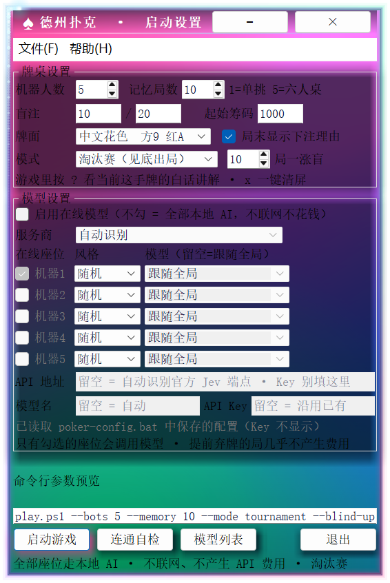

# 命令行德州扑克 · 你 vs 5 个 AI

一个跑在终端里的单机无限注德州扑克（NLHE）。你坐一桌，对面 1~5 个 AI 机器人，每个座位有自己的打法和跨手记忆；**不联网也能打，不花一分钱**，想更强可以接在线模型。

游戏本体只用 Python 标准库，零第三方依赖。



## 和一般"人机扑克"不一样的几件事

**机器人真的会诈唬。** 下注范围里约 23% 是胜率低于 35% 的空手（随机翻后局面统计），它有纯诈唬、听牌半诈唬、跨街连开两枪、强牌过牌设陷阱、面对小注反加诈唬。你看到它下注就弃牌，会被偷到怀疑人生。

**胜率不是"假设对手随便两张牌"。** 它会根据你这手牌的行动线收窄你的范围再算胜率——你翻前加注过，它就不会再假设你手里是 72o。同一个 K9o，对随机牌是 58%，对真实加注范围只有 38%。

**它会记住你。** 跨手记忆统计你的入池率、翻前加注率、面对下注的弃牌率、摊牌记录和净输赢，然后针对你调整：你爱弃牌它就多偷，你是跟注站它就只做价值。换个对手（删 `poker-memory.json` 或用 `--forget`）它就重新认识你。

**它不会偷看你的牌。** 快照里只有它自己的底牌 + 公共信息，对手对象只有 `name/stack/round_bet/folded/all_in` 五个字段。这条有专门的回归测试守着。

**每一步都告诉你为什么。** 局末自动亮牌并列出每个座位的决策理由（中文白话），`r` 看完整复盘，`s` 导出 JSON。你能看清自己刚才是被价值了还是被偷了。

## 快速开始

需要 Python 3.10+（用了 `X | None` 类型标注）。游戏本体零第三方依赖。

```bash
git clone https://github.com/tian-1997/poker-deepseek.git
cd poker-deepseek
python poker.py
```

无参数启动就是默认配置：**6 人桌（你 + 5 机器人）· 淘汰赛 · 全部本地 AI**。

### 牌桌操作

| 按键 | 作用 |
|---|---|
| `f` | 弃牌 |
| `c` | 跟注 / 过牌 |
| `r<金额>` | 加注到（如 `r120`，直接回车 = 最小加注） |
| `a` | 全下 |
| `?` | 白话讲解当前局面 |
| `x` | 一键清屏（摸鱼用） |
| `h` | 看帮助 |

局末：`n` 下一局 · `0` 按当前配置重开一整场 · `r` 详细复盘 · `s` 导出 JSON · `q` 退出。

### 图形启动器（可选）

想要个可视化配置面板（选人数、模式、每座位风格和模型），用 `launcher.pyw`，它需要 PyQt5：

```bash
pip install PyQt5
python launcher.pyw
```

Windows 上可以打成独立 exe，对方无需装 Python：

```powershell
powershell -ExecutionPolicy Bypass -File build-exe.ps1
```

## 常用参数

```
--bots N              机器人数量 1~5，默认 5
--mode cash|tournament  cash 现金局（可补筹码）/ tournament 淘汰赛（默认，见底出局打到只剩一人）
--blind-up N          每 N 局盲注翻倍，默认 0 不涨（淘汰赛建议 8~12）
--stack / --sb / --bb 起始筹码 1000 / 小盲 10 / 大盲 20
--sims N              本地 AI 蒙特卡洛次数，默认 140（越大越准越慢）
--bluff X             本地 AI 诈唬强度倍率，默认 1.0；0 = 老实版，2 = 疯
--memory N            跨手记忆窗口局数，默认 10；0 = 关闭
--forget              清空对手画像后开始
--cards cn|ascii|pretty  牌面样式，默认中文（方9 红A）
--show-styles         局内标出每个座位的风格（默认隐藏，退出时才揭晓）
--seat-styles 1=紧凶,3=松凶   给指定座位单独指定风格
--no-reasons          局末不自动列理由
--seed N              固定随机种子，便于复现
```

风格池：`随机 / 稳健 / 激进 / 紧凶 / 松凶 / 跟注站`。选「随机」= 开局抽签，一桌尽量不重样；重开一场会重新抽。

## 接入在线模型（可选）

默认全本地 AI，不联网。想让某个座位走在线模型：

```bash
# TypeSafe Jev 决策模型（官方 key 以 apikey_ 开头，只填 key 即可自动补端点）
export JEV_API_KEY=apikey_...
python poker.py --llm-bots 2

# 或任何 OpenAI 兼容网关
export JEV_BASE_URL=https://api.deepseek.com
export JEV_MODEL=deepseek-flash
export JEV_API_KEY=sk-...
python poker.py --llm-bots 5 --provider openai
```

先用 `python poker.py --check` 验证连通，`--models` 列出可用模型。

**不要把自己的 key 提交进仓库。** `poker-config.bat`（放真实 key 的本地配置文件）已经在 `.gitignore` 里，仓库里只留 `poker-config.sample.bat` 模板。

## 项目结构

| 文件 | 职责 |
|---|---|
| `poker.py` | 入口：参数解析、牌桌渲染、主循环、局末菜单与重开 |
| `engine.py` | 规则引擎：发牌、下注轮、边池、短码全下、按钮轮换、快照 |
| `cards.py` | 牌与 7 张取最优 5 张的牌型比较 |
| `deepseek.py` | 机器人决策：本地 AI（翻前牌力表 + 范围化胜率 + 诈唬系统）、在线模型调用与降级 |
| `preflop_table.py` | 169 手起手牌对随机单挑的胜率表（`_gen_preflop_table.py` 生成） |
| `memory.py` | 跨手对手画像：VPIP / PFR / 侵略性 / 弃牌率 / 摊牌 / 最近动作串 |
| `jev.py` | TypeSafe Jev 决策模型的请求与状态构造 |
| `launcher.pyw` | PyQt5 启动器（Windows XP 风格界面） |
| `test_poker.py` | 115 项单元测试 |

## 测试与基准

```bash
# 全套单测（启动器 UI 测试需要 PyQt5，缺了会自动跳过）
python -m unittest -q test_poker

# 关键牌例：新旧版本动作分布对照
python _bench.py --spots

# 复式自对弈 A/B（同一副牌打两遍、座位对调，抵消牌运）
python _bench.py --selfplay 2000 --sims 25
```

本地 AI 改造前后对比（2000 手复式自对弈，`--sims 25`）：**新版 +285 bb/100，95% CI [+187, +383]**。

单点行为变化示例：

| 牌例 | 改造前 | 改造后 |
|---|---|---|
| 72o 枪口无人入池 | 弃牌 58% | 弃牌 100% |
| K9o 面对 3bet | 跟注 82% | 弃牌 100% |
| 中对面对 1/3 底池 | 加注 57% | 跟注 95% |

`_baseline_deepseek.py` 是改造前冻结的基线，只给 `_bench.py` 做 A/B 对照用，不参与游戏运行。

## 说明

- 本地 AI 的强度基于「牌力表 + 范围估计 + 启发式规则」，不是解算器/GTO 表，打法近似而非最优。
- 跨手记忆存在同目录 `poker-memory.json`，只记统计量，不记任何人的底牌。
- 这个项目是**单机人机对战**，没有真人对赌、没有充值、没有提现、没有抽头。请勿把它改成多人对赌或任何形式的赌博应用——在中国，那属于《刑法》第 303 条开设赌场罪的范畴。

## License

[MIT](LICENSE)
